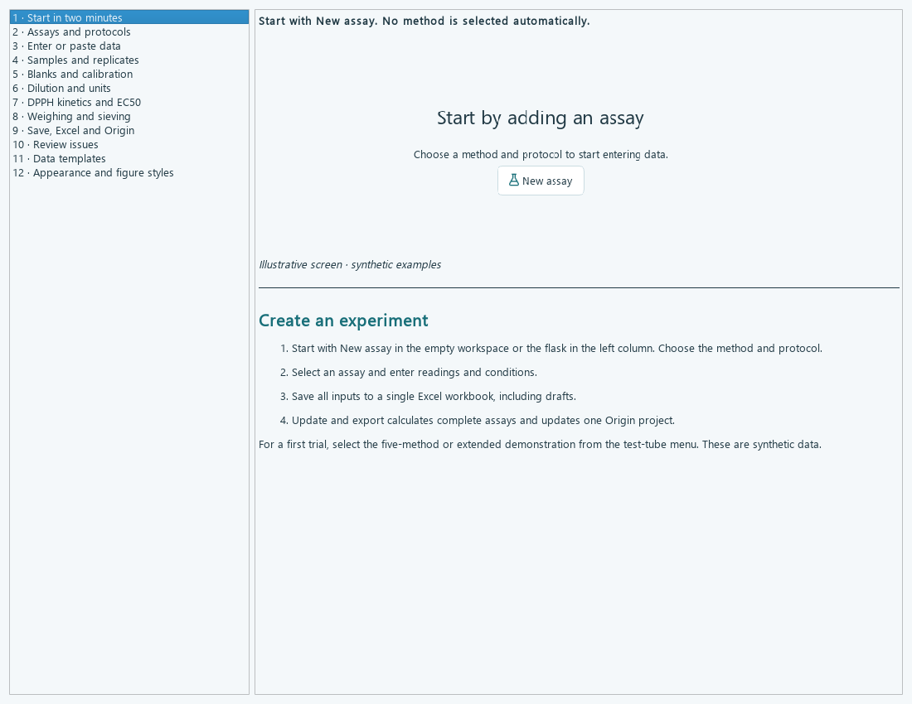

# PhDexLab

**A personal, AI-assisted Windows application by [RpastranaE](https://github.com/RpastranaE).** Developed iteratively with OpenAI ChatGPT/Codex assistance. This is an independent personal project, not an official product of OpenAI, Microsoft, OriginLab, a university or a laboratory.

PhDexLab coordinates manual experimental data entry, an auditable Excel workbook and editable OriginPro 2024 graphs. It runs independently of PhDex; its modules and API are intended for possible future integration.

[Download Windows app](https://github.com/RpastranaE/PhDexLab/releases/latest) · [Guía en español](docs/GUIA_v0.9.md) · [Validation](docs/VALIDATION.md) · [Update design](docs/UPDATES.md)



## Use on Windows

Download **PhDexLab-Setup-0.9.0.exe** from Releases and run it. The per-user installer creates a normal application folder, desktop/Start menu shortcuts and an uninstaller. No administrator account or separate Python installation is required. English is the default on first use; existing language preferences are preserved. A portable ZIP remains available for the updater and optional portable use. Desktop Microsoft Excel and a licensed OriginPro 2024 installation are needed for the complete workflow; Excel-only mode does not require Origin. These commercial applications are not bundled. The executable is unsigned.

The update button checks this repository's latest stable release. Automatic checking and verified background downloads are enabled by default in the installed app, with installation on normal exit. They can be disabled. Updates replace `Application` only, preserve experiments and personal settings, test startup and attempt rollback on failure. No experimental data are uploaded.

## Capabilities

- A single experiment contains several assays, each with its own protocol, calibration, blanks, technical readings and biological units.
- One workbook, organised by assay, with visible formulas, QC, summaries and original inputs.
- One editable Origin project, organised by assay/Data/Graphs, plus PNG/PDF/SVG exports by assay.
- Explicit Excel recalculation and Origin refresh; verified unchanged outputs are reused. Automatic Excel-to-Origin synchronisation is **not** claimed.
- FRAP, ABTS, CUPRAC, TPC, TFC, kinetic DPPH/EC50, moisture, dry matter, ash and sieving engines; configurable, versioned protocol variants.
- An empty initial workspace, explicit assay creation, Excel-style select-and-type editing, reusable input templates, Spanish/English interface and light/dark mode.
- Illustrated help in both languages, opened automatically once on first real launch.
- Workbook-open checks and actionable close-and-retry messages; no user Excel session is closed automatically.
- Ten plot presets and separate palette/marker/line/font controls for results, calibration and dose curves; portable custom styles.

**Scientific scope:** protocol presets are starting points, not validated analytical methods for your matrix. Incomplete procedures remain blocked until their missing conditions are supplied. Numerical tests do not constitute experimental validation. Synthetic demonstrations are explicitly labelled. Review calibration, controls, units and replicate independence before interpreting any result. Private source snapshots, private workspace URLs and experiments are excluded from this repository.

## Run from source

Use 64-bit Python 3.12 on Windows. Double-click `PhDexLab.bat` to prepare the environment on first use and launch. Alternatively:

```powershell
python -m venv .venv
.venv/Scripts/python.exe -m pip install -r requirements.txt
.venv/Scripts/python.exe -m phdexlab
```

Run tests using `.venv/Scripts/python.exe -m pip install pytest`, then `.venv/Scripts/python.exe -m pytest`. Excel/Origin integration checks require the actual installed applications and are described separately in the validation notes. Source installations do not replace themselves with binary updates.

`Build-Windows.ps1` builds the application. With the official Inno Setup 6 compiler installed, `Build-Installer.ps1 -Compiler <path-to-ISCC.exe>` creates the single-file installer. `tools/package_windows.py` adds redistribution notices and creates the exact hashed ZIP consumed by the updater. `tools/publish_release.ps1` publishes a versioned release using GitHub CLI after a reviewed build. See [release instructions](docs/UPDATES.md).

## Structure

`protocols` / `method_catalog`, `data_entry`, `calculations` / `assay_engine`, `excel` / `multi_excel`, `origin` / `multi_origin`, `interface` / `workspace`, and `integration` / `experiments` separate analytical definitions, input, calculation, presentation and orchestration. The updater does not receive experimental content.

## Licence and contributions

Original project code is MIT-licensed. Dependencies retain their own licences, including Qt/PySide under LGPLv3; notices and replacement/rebuild information accompany the Windows package. Contributions and bug reports are welcome. Do not attach private data to public issues. Software is provided as-is without warranty.
