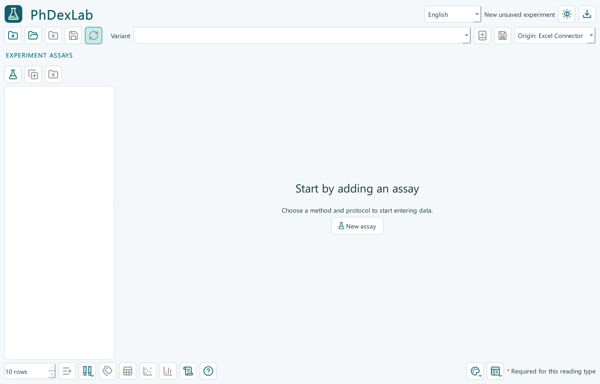

# PhDexLab

PhDexLab es una aplicación para **Windows** que reúne los datos de varios ensayos de química en **un Excel maestro y un proyecto editable de OriginPro**. Permite introducir lecturas manualmente, conservar las condiciones del protocolo, recalcular resultados y exportar figuras por ensayo.

Es un **proyecto personal de [RpastranaE](https://github.com/RpastranaE), desarrollado con asistencia de IA —ChatGPT/Codex—**. Funciona de forma autónoma; la integración con PhDex queda como posibilidad futura. No es un producto oficial de OpenAI, Microsoft, OriginLab ni una institución académica.

## Descargar e instalar

1. Abre la [última versión publicada](https://github.com/RpastranaE/PhDexLab/releases/latest).
2. En **Assets**, descarga **`PhDexLab-Setup-X.Y.Z.exe`**. Es el instalador; sustituye X.Y.Z por la versión que aparezca en esa página.
3. Ejecútalo y abre PhDexLab desde el acceso directo. No necesitas instalar Python para esta opción.

El cálculo necesita **Microsoft Excel de escritorio**. Para generar el proyecto y las figuras de Origin también necesitas **OriginPro 2024 instalado y con licencia**. Esas aplicaciones no están incluidas. La primera ejecución utiliza inglés y abre la ayuda; puedes elegir español y se recuerda tu preferencia. El instalador y el ejecutable no tienen firma de código.

## Tu primer experimento

**Nuevo ensayo → introducir datos y condiciones → cerrar el libro de Excel → actualizar y exportar → Resultados finales.** La actualización guarda primero las entradas actuales; si el experimento es nuevo, pide su carpeta. También puedes guardar un borrador sin calcular.

La aplicación empieza sin un método seleccionado. Cada ensayo mantiene su calibración y sus resultados; distintas muestras pueden compartir la calibración de ese ensayo. El menú de datos sintéticos permite practicar sin utilizar mediciones reales.

## Una documentación, según lo que necesites

| Quiero… | Leer |
|---|---|
| Instalar, aprender a usar la aplicación y resolver problemas | **[Manual de uso](docs/MANUAL.md)** |
| Descargar el código, modificarlo, ejecutar pruebas o crear un instalador | **[Desarrollo y compilación](docs/DEVELOPMENT.md)** |
| Consultar las publicaciones de los protocolos | [Fuentes de los métodos](docs/PROTOCOL_SOURCES.md) |
| Saber qué se ha comprobado y cuáles son los límites | [Validación del software](docs/VALIDATION.md) |
| Ver qué cambió entre versiones | [Historial de cambios](CHANGELOG.md) |

La documentación principal está en español y utiliza los nombres de los controles en inglés/español para que puedas seguirla en ambos idiomas de la aplicación. Las guías por versión se conservan como archivo histórico; **no hace falta leerlas para empezar**.

## Qué incluye

- FRAP, ABTS, CUPRAC, TPC, TFC, DPPH cinético/EC50, humedad, materia seca, cenizas y granulometría, con variantes de protocolo.
- Entrada guiada de lecturas individuales o medias, pegado, arrastre de series, numeración de repeticiones y deshacer/rehacer; repeticiones técnicas y unidades experimentales separadas, con plantillas reutilizables y gestionables.
- Un Excel compacto con resumen global y dos pestañas por ensayo, fórmulas visibles, resultados y controles de calidad; estilos de Excel personalizables.
- Un proyecto Origin organizado por ensayo y exportaciones PNG/PDF/SVG; estilos de resultados, calibración y curvas de dosis personalizables.
- Actualización explícita de resultados, interfaz español/inglés, modo claro/oscuro y ayuda ilustrada.
- Pestaña de resultados finales con valores guardados, calibrado y figuras reales de Origin ampliables. Validación con avisos por ensayo/fila/campo y celdas pendientes resaltadas solo tras intentar actualizar.

Las plantillas son puntos de partida documentales: **no certifican que un método esté validado para tu muestra**. La aplicación no inventa condiciones faltantes ni declara independencia de las réplicas. Consulta el [alcance de validación](docs/VALIDATION.md).

## Problemas, contribuciones y licencia

Contacto: **rpe10@alu.ua.es**. Para comunicar un fallo, abre una [incidencia](https://github.com/RpastranaE/PhDexLab/issues) con versión, pasos para reproducirlo y un ejemplo sintético. Revisa los archivos antes de compartirlos: las incidencias son públicas. Para proponer código, empieza por la [guía de desarrollo](docs/DEVELOPMENT.md).

El código original se distribuye bajo [licencia MIT](LICENSE). Las dependencias mantienen sus licencias y [avisos correspondientes](THIRD_PARTY_NOTICES.md).
