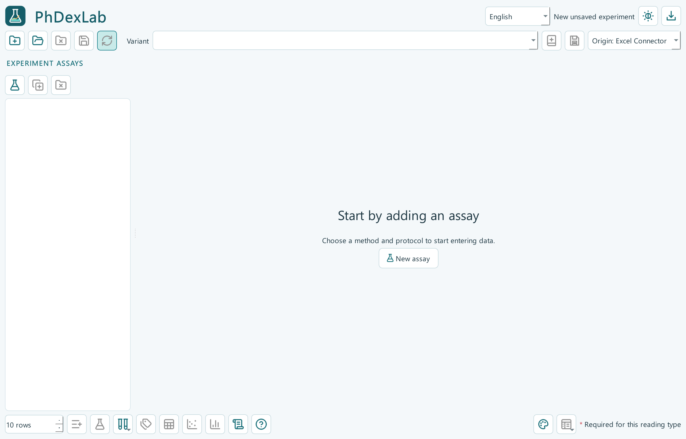
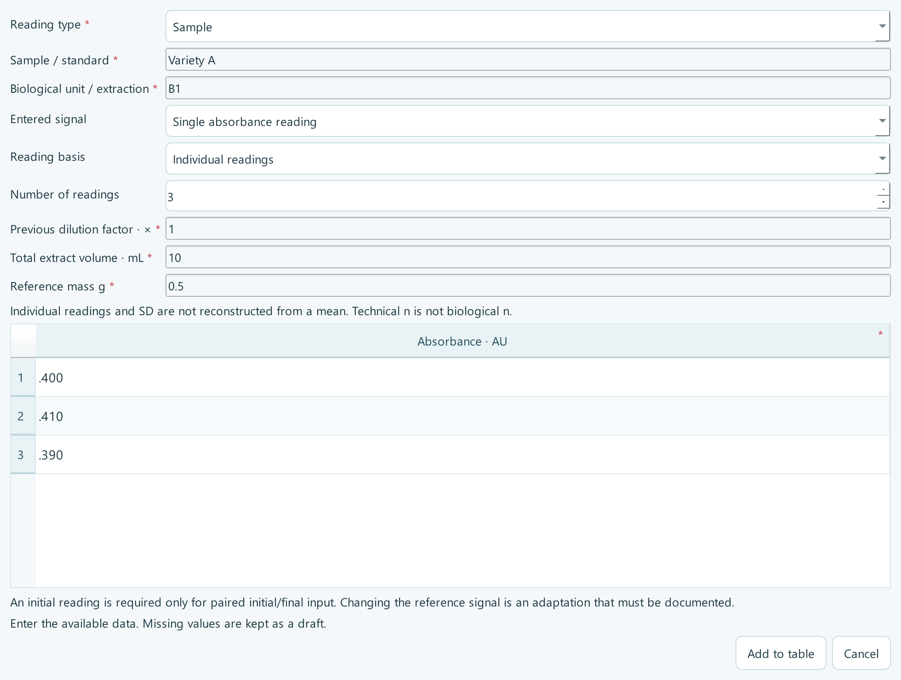
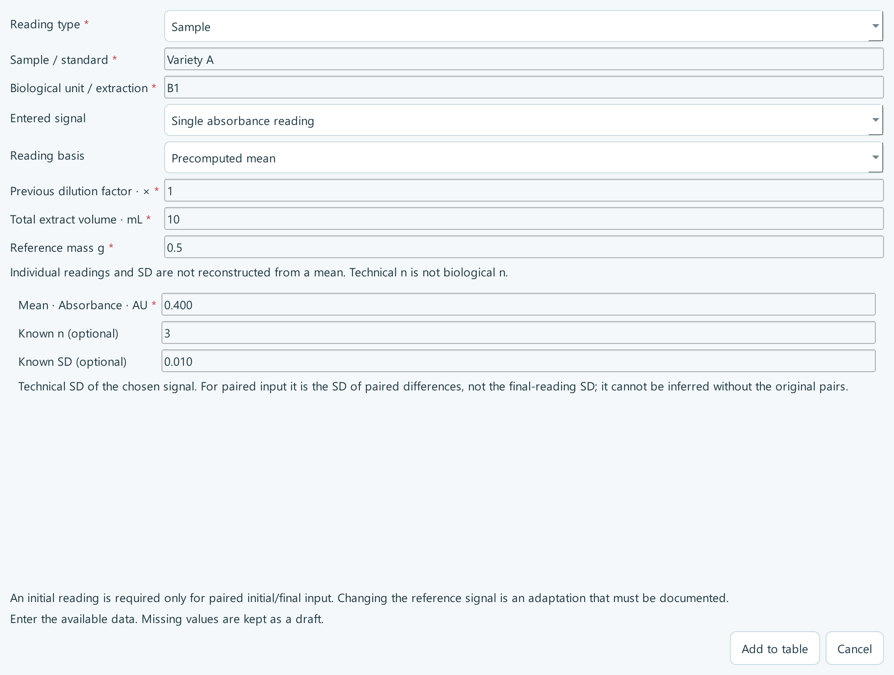

# Manual de PhDexLab

[Inicio](../README.md) · [Índice de documentación](README.md) · [Desarrollo](DEVELOPMENT.md) · [Historial](../CHANGELOG.md)

Esta es la guía de uso vigente. Las guías por versión se conservan en [el archivo histórico](archive/README.md). La interfaz permite español e inglés; aquí se indican los nombres de los controles en ambos idiomas cuando resulta útil.

## 1. Qué hace y qué necesitas

PhDexLab reúne datos introducidos manualmente, protocolos, un Excel con cálculos auditables y un proyecto de Origin con gráficos editables. Es una aplicación independiente: no requiere PhDex ni lo modifica.

Un **experimento** es la carpeta completa del trabajo. Contiene uno o varios **ensayos**: por ejemplo FRAP, CUPRAC y TPC de las mismas muestras. Cada ensayo tiene su propio protocolo, datos, calibración y resultados. Un **protocolo** define condiciones y reglas de cálculo; una variante conserva una versión concreta de esas condiciones.

Necesitas Windows de 64 bits. La aplicación instalada incluye Python y sus bibliotecas. Para recalcular el Excel necesitas Microsoft Excel de escritorio; para generar el proyecto y las figuras nativas de Origin necesitas OriginPro 2024 instalado, con licencia y automatización disponible. Tener las bibliotecas instaladas no garantiza que la automatización local funcione: utiliza Diagnóstico y una prueba con datos sintéticos.

El programa no valida por sí mismo un método analítico. Antes de usar resultados científicos revisa las condiciones, unidades, blancos, calibración y controles de calidad. Consulta [las fuentes y limitaciones de los protocolos](PROTOCOL_SOURCES.md).

## 2. Descargar e instalar

1. Abre [la última versión publicada](https://github.com/RpastranaE/PhDexLab/releases/latest).
2. En **Assets**, descarga `PhDexLab-Setup-X.Y.Z.exe` y ejecútalo.
3. Abre el acceso directo de PhDexLab del escritorio o del menú Inicio. La primera apertura muestra la ayuda. El idioma inicial es inglés y se puede cambiar en la aplicación.

El instalador incluye las dependencias y crea una instalación por usuario. No necesitas mantener archivos al lado del instalador. La carpeta instalada contiene `Application`, que sí necesita conservar sus archivos internos. No extraigas solo su ejecutable.

La alternativa `PhDexLab-Windows-x64.zip` es una distribución portátil: extrae **todo** el ZIP. `latest.json` es información del actualizador; `SHA256SUMS.txt` permite comprobar la integridad de las descargas. Los enlaces **Source code** contienen el código, no una instalación lista para usar. El ejecutable no dispone de firma comercial de Windows.

Guarda tus experimentos fuera de `Application`. La actualización reemplaza esa carpeta de programa. Una copia de seguridad debe incluir la carpeta completa del experimento.

## 3. Primera prueba sin datos reales

Abre el menú de datos sintéticos y elige una demostración con varios ensayos o variedades. Guarda en una carpeta nueva, por ejemplo `DEMO_001`. Cierra cualquier Excel o proyecto de Origin de esa prueba y pulsa **Actualizar y exportar / Update and export**.

Elige el modo de Origin que corresponda: conexión con Excel, valores copiados o sin Origin. Al terminar, revisa el estado, el registro, el Excel y las figuras. Esta prueba sirve para comprobar tu instalación, sin interpretar sus números como medidas reales.



## 4. Crear, abrir y cerrar experimentos

La aplicación empieza sin ensayos seleccionados. Pulsa **Nuevo ensayo / New assay**, selecciona el método y el protocolo y asigna un nombre reconocible. Puedes añadir otro ensayo con otro método o repetir un método con otra calibración o lote.

**Duplicar ensayo** copia su diseño para trabajar por separado. **Guardar protocolo como variante** conserva condiciones del método: no equivale a duplicar un ensayo ni a guardar una plantilla de datos.

Para continuar un trabajo, abre su carpeta raíz desde la aplicación. **Cerrar experimento** vuelve a la pantalla vacía; no elimina la carpeta. Guarda antes de cerrar si quieres conservar las modificaciones de la tabla.

## 5. Introducir datos

### Lecturas individuales o una media

Pulsa **Añadir lecturas o una media / Add readings or a mean**, el botón de pipeta sobre la tabla. Elige tipo de lectura, muestra/patrón y unidad biológica. Puedes introducir 3, 5 o más absorbancias, o elegir **Media ya calculada / Precomputed mean** y escribir solo esa media. Las casillas vacías que sobren no se cuentan como medidas; una pareja parcialmente rellenada sigue pendiente.



Para una media, n técnico y DE de respuesta son opcionales: déjalos vacíos si no los conoces. La aplicación conserva un único registro identificado como media; no inventa réplicas ni una dispersión. La DE corresponde a la respuesta efectiva utilizada; para parejas es la DE de las diferencias, no la DE final aislada. Las incertidumbres de blancos no se propagan como incertidumbre metrológica.



Usa un modo por unidad biológica y condición: no mezcles una media con sus propias lecturas. Puedes tener una unidad con lecturas individuales y otra con una media. Una media global de 27 lecturas no se convierte en 27 unidades biológicas. El menú sintético incluye **Demo con medias ya calculadas** para practicar.

### Qué significa la señal

- **Lectura única:** una absorbancia por lectura, al tiempo del protocolo. No hay campo inicial.
- **Incremento ΔA ya medido:** introduce el incremento que entrega el equipo. No vuelvas a restar una inicial.
- **Pareja inicial/final:** introduce ambas medidas de cada pareja; Excel calcula su diferencia. Solo este modo requiere una inicial.

El FRAP Fe(II) de referencia conserva el incremento definido en el protocolo original. Si eliges lectura única, el programa registra una adaptación respecto a la referencia. No reinterpreta automáticamente los números ya introducidos: crea otro ensayo o borra explícitamente esas medidas antes de cambiar de señal. ABTS y DPPH utilizan absorbancias y un control radical; ese control no es una inicial de la muestra.


En RAW, cada fila representa una lectura original o una media aportada identificada como tal. Las pesadas y fracciones usan sus campos específicos. El tipo de lectura se elige de una lista: patrón, blanco, control o muestra, según el método. Puedes añadir nombres personalizados vinculados a esas categorías. Los identificadores internos se generan automáticamente.

Un clic selecciona la celda. Escribir sustituye su contenido; F2 o doble clic permite editar el texto existente. Supr deja vacías las celdas seleccionadas. Ctrl+C, Ctrl+X y Ctrl+V permiten copiar, cortar y pegar. El menú con clic derecho permite insertar una cantidad de filas, eliminar las seleccionadas, copiar filas completas y pegarlas como filas nuevas; estas reciben identificadores internos nuevos. Puedes pegar una tabla de Excel con tabulaciones desde la celda seleccionada. Añade las filas necesarias con el control de cantidad de filas. Los asteriscos rojos indican campos obligatorios para la categoría y el protocolo de esa fila. Las columnas atenuadas no se utilizan en ese contexto.

Las ayudas de las cabeceras explican qué introducir. No confundas un campo vacío con un cero medido. Usa valores numéricos y las unidades indicadas; el programa admite coma o punto decimal en la entrada manual.

| Campo | Qué significa |
| --- | --- |
| Muestra / Sample | Nombre que agrupa los resultados de esa muestra o variedad. |
| Réplica biológica | Identifica muestras biológicas independientes. |
| Réplica técnica | Lecturas repetidas del mismo material biológico. |
| Concentración del patrón | Concentración en las unidades del protocolo, utilizada para la calibración. |
| Dilución | Factor adimensional: 1 es sin diluir; 2 significa llevar una parte de extracto a dos partes de volumen total. No escribas una razón como `1:2`. |
| Volumen de extracto | Volumen total de extracción en mL, cuando el cálculo lo requiere; no el volumen de una alícuota. |
| Masa | Masa en g utilizada para expresar el resultado. Comprueba si corresponde a base seca o húmeda. |
| Corrección de matriz | Corrección adicional de señal definida en el protocolo; consulta la ayuda del método antes de aplicarla. |

### Varias variedades y réplicas

Usa nombres distintos en **Muestra**, por ejemplo `Variety A` y `Variety B`, dentro del mismo ensayo. Comparten la calibración de ese ensayo y se presentan como resultados separados. Para otra calibración, crea otro ensayo.

Las réplicas técnicas se agrupan antes de resumir las biológicas. Tres lecturas de una misma extracción no equivalen a tres muestras biológicas independientes. Las demostraciones con variedades permiten comprobar esta diferencia. El mismo nombre en FRAP y TPC no mezcla sus resultados ni sus unidades.

Puedes medir una extracción a varias diluciones y mantener el mismo nombre y unidad biológica. Cada lectura individual lleva su factor de dilución; el programa la corrige **antes** de promediar. Puedes repetir los números de réplica técnica en otra dilución. La masa y el volumen total representado deben seguir siendo los de la misma extracción. Si introduces medias en lugar de lecturas individuales, conserva una sola media por unidad: no se mezclan medias de diferentes diluciones sin sus observaciones originales.

### Resultado por masa y recuperación de un control

**Muestra / Sample** calcula el resultado final con dilución, volumen total de extracto y masa. **Control de calidad / Quality control** comprueba una concentración conocida y devuelve recuperación en porcentaje. No lo utilices para una muestra que deba dar FRAP, TPC, etc. por gramo. Si un control lleva masa/volumen/dilución, la app pide corregir el tipo o vaciar esos campos, en vez de ignorarlos.

Para FRAP Fe(II), cuando el eje del calibrado representa concentración antes de reacción:

`µmol eq Fe(II)/g = C_equivalente (µmol/L) × FD × volumen_extracto (mL) / (1000 × masa (g))`

Ejemplo: 200 µmol/L, FD=10, 10 mL y 0,5 g dan **40 µmol/g**, sin porcentaje ni otro factor de reacción. Si el eje es concentración **final** en la mezcla, se recupera primero la concentración de la alícuota con el volumen de reacción/alícuota. No incluyas esa corrección otra vez en FD.

En Excel, **Processing G:M** muestra los pasos y **E** el resultado con su unidad en **F**. **Results** indica la unidad de cada fila; **Summary** y las figuras incluyen solo muestras. El factor 100 de las variantes mg/100 g cambia la masa de referencia: no es un porcentaje. Consulta [la revisión de todos los métodos](PROTOCOL_SOURCES.md#calculation-and-methodology-audit-for-093) para equivalentes, conversiones y límites.

La nueva plantilla TFC utiliza **extracto seco**, como su fuente operativa. Si ya tienes un experimento guardado con «hoja seca», comprueba qué masa representa realmente antes de cambiarla: una actualización conserva los protocolos archivados. Para pasar de resultados por gramo de extracto a resultados por gramo de hoja hace falta la masa de hoja representada o el rendimiento de extracción. DPPH informa EC50 en mg de extracto/mL de mezcla final; no equivale a la EC50 en relación molar del artículo original.

## 6. Protocolos y plantillas

En **Protocolo y condiciones / Protocol and conditions** revisa unidades, concentraciones, diluciones y demás parámetros. Los primeros controles permiten elegir señal, entrada preferida, número de lecturas propuesto, corrección de muestra, tratamiento del blanco y valores por defecto de dilución, volumen de extracción y masa. También puedes configurar el mínimo de niveles de calibración (3 por defecto; mínimo matemático de 2). Dos puntos no demuestran linealidad.

El número de lecturas prepara el formulario y es editable por entrada; no impone triplicados. El TPC base propone duplicados; en gravimetría se propone una fila por unidad para no presentar alícuotas independientes como técnicas de la misma unidad.

Para activar estas opciones en un experimento anterior, pulsa la flecha de la pipeta → **Configurar entrada en Protocolo y condiciones**. Se conservan sus lecturas y señal; guarda para conservar la activación. Las plantillas de datos antiguas compatibles se pueden cargar sin copiar medidas ni inventar precisión. Los experimentos con el diseño nuevo requieren 0.9.2 o posterior para abrirse; las versiones anteriores no conocen sus columnas de procedencia. Guardar una variante crea una versión para reutilizar esas condiciones; el experimento conserva la versión que utilizó. No cambia retrospectivamente todos los experimentos anteriores.

La ficha de metodología incluye las fuentes originales. Una adaptación bibliográfica no implica que las condiciones hayan sido validadas para tu matriz. Los métodos con condiciones pendientes requieren completarlas. No interpretes un resultado de equivalentes, un porcentaje de inhibición y un EC50 como magnitudes intercambiables. En dosis-respuesta, revisa la definición de dosis y la cobertura del intervalo: no fuerces una extrapolación fuera de los datos.

Las **plantillas de datos** reutilizan el diseño: nombres de muestras, patrones y réplicas. Comprueba si al guardarlas has elegido incluir medidas. En una plantilla para nuevas medidas conviene dejar absorbancias y masas medidas vacías. Al cargarla, revisa su compatibilidad con el método seleccionado.

Crear una variante desde la interfaz sirve para modificar condiciones de un cálculo existente. Incorporar un motor de cálculo distinto requiere modificar el código; se explica en [Desarrollo](DEVELOPMENT.md).

### Blanco de reactivos y corrección de muestra

El blanco de reactivos representa la señal de reactivos/disolvente y se aplica una sola vez. El fondo propio de muestra es otra medida: su color o turbidez sin el cromóforo correspondiente, bajo condiciones equivalentes. Solo activa **Blanco propio de muestra (neto)** si lo has medido y puedes justificar su uso. Introduce su contribución adicional neta, ya corregida frente a su propio blanco; para ΔA debe corresponder al incremento.

Ejemplo de lectura única: 0,620 de muestra − 0,020 de reactivos − 0,030 de fondo neto = 0,570 AU. No introduzcas 0,020 otra vez como fondo de muestra. Por defecto, los protocolos nuevos usan **Sin corrección adicional** y ocultan ese campo: no necesitas rellenar ceros.

Si el instrumento ya puso a cero las lecturas con el blanco de reactivos, los métodos colorimétricos permiten declararlo expresamente. No se inventa una medida de blanco y no se vuelve a restar. ABTS y DPPH siguen necesitando su control radical. Si hay correcciones no nulas guardadas, desactivarlas no elimina ni ignora esos valores: debes revisarlos.

## 7. Guardar, recalcular y exportar

**Guardar** conserva los datos y condiciones del experimento. Tras crear una carpeta nueva, puedes elegir calcular y exportar inmediatamente o seguir editando. **Actualizar y exportar** recalcula mediante Excel, comprueba los resultados, actualiza Origin si está habilitado y exporta las figuras. Son operaciones diferentes.

Cierra el libro del experimento en Excel y su proyecto en Origin antes de actualizar. Si estás abriendo el Excel, espera, guarda y ciérralo. El programa evita sobrescribir un libro en uso. La barra integrada muestra las fases; el registro aporta detalles cuando una fase falla.

Puedes modificar manualmente las entradas editables del Excel. Mantén sus nombres de hojas, cabeceras e identificadores y no sobrescribas las fórmulas. Después usa la actualización explícita. Si también vas a editar los datos en la aplicación, vuelve a abrir el experimento para leer los cambios externos antes de guardar la tabla: una tabla antigua no representa necesariamente el Excel que acabas de modificar.

Los modos de Origin son:

| Modo | Comportamiento |
| --- | --- |
| Conector Excel | Intenta establecer la conexión con las hojas de resultados. Su disponibilidad depende de Origin local. |
| Valores | Transfiere los resultados calculados a Origin de forma explícita. |
| Sin Origin | Permite trabajar sin crear el proyecto nativo. Las figuras alternativas utilizan los resultados disponibles. |

No se promete sincronización permanente al escribir en Excel. La acción fiable es **Actualizar y exportar**. Revisa los controles de calidad y avisos antes de usar los resultados. Un archivo generado correctamente puede contener datos insuficientes o un ensayo pendiente de revisión.

## 8. Dónde están los archivos

Ejemplo de organización; los nombres de los ensayos dependen de tu experimento:

```text
EXP_001/
  Documents/
    EXP_001.xlsx
    EXP_001.opju
  Figures/
    A01_FRAP/
      Excel/
      Origin/
      Publication/
    A02_TPC/
      ...
  Results/
    ...
  _internal/
    ...
```

`Documents` contiene los archivos de trabajo principales; `Figures` separa las exportaciones por ensayo y generador. El Excel separa ensayos por hojas y Origin por carpetas. `_internal` conserva versiones, estado y trazabilidad: no necesitas editarlo para usar el programa, pero forma parte del experimento.

Los botones de Excel y Origin abren sus archivos. El botón de figuras abre la carpeta general si hay varios ensayos; con un único ensayo y figuras disponibles puede abrir directamente su carpeta. Antes de generar figuras, la carpeta puede estar vacía.

Para mover o respaldar el trabajo, copia toda la carpeta raíz. Los nombres principales proceden del nombre del experimento al crearlo; renombrar archivos individuales puede romper referencias.

## 9. Idioma, apariencia y gráficos

El selector de idioma cambia la interfaz; el selector claro/oscuro cambia su apariencia. Los nombres de muestra y textos introducidos por ti no se traducen automáticamente. Los gráficos científicos utilizan inglés.

La ventana de estilos permite elegir una plantilla y ajustar colores, símbolos —incluida la opción **Sin símbolos / No markers**—, líneas, barras de error y tipografía por tipo de gráfica. Ocultar símbolos no elimina medidas, barras de error ni líneas de ajuste. La previsualización usa ejemplos: no recalcula el experimento. Para aplicar cambios a archivos exportados, guarda el estilo y actualiza los resultados.

Las figuras de **Origin** pertenecen al proyecto editable. **Publication** ofrece exportaciones alternativas. Revisa las unidades, el número de réplicas, las barras de error y la legibilidad al tamaño final del artículo. Si haces ajustes manuales en Origin, conserva una copia antes de regenerar: una reconstrucción puede reemplazar los gráficos generados.

## 10. Actualizaciones

Al iniciar, la aplicación instalada busca versiones en segundo plano, salvo que hayas desactivado esa preferencia. Si encuentra una nueva, abre la ventana de actualización y ofrece **Actualizar ahora / Update now** o **Actualizar al salir / Update on exit**. Ambas opciones reinician PhDexLab después de instalar. La descarga muestra su progreso en esa ventana; los cambios sin guardar y los procesos de análisis siguen protegidos. También puedes buscar y elegir la actualización manualmente desde ese menú. Mantén los experimentos fuera de `Application`. El actualizador verifica el paquete y comprueba el arranque; si falla, intenta restaurar la versión anterior. Conserva una copia de seguridad independiente de tus trabajos.

Si utilizas la versión 0.7.0 y aparece `[Errno 2]` al buscar actualizaciones, instala manualmente la última versión desde GitHub una vez. No necesitas instalar las versiones intermedias. Para una copia del código modificada por ti, utiliza Git y tu entorno de desarrollo en lugar del actualizador binario.

## 11. Resolver problemas

| Problema | Qué comprobar |
| --- | --- |
| Excel está en uso o abriéndose | Guarda y cierra ese libro, espera a que termine de cerrarse y vuelve a actualizar. |
| Los cambios externos no aparecen en la tabla | Vuelve a abrir el experimento antes de editarlo y guardarlo desde la aplicación. |
| Faltan resultados | Revisa los campos obligatorios, blancos, patrones y controles de calidad del ensayo. |
| No se crea Origin | Comprueba instalación, licencia, diagnóstico y modo seleccionado; prueba con datos sintéticos. |
| La carpeta de figuras está vacía | Guarda y ejecuta la actualización; revisa en el registro qué fase terminó. |
| Un estilo nuevo no aparece en los archivos | Guarda el estilo y regenera las exportaciones. |
| Falla la consulta de actualizaciones | Reintenta con conexión a Internet o descarga el instalador de la última versión. |
| Un error interrumpe la generación | Conserva la carpeta y consulta el registro antes de borrar o editar archivos internos. |

Puedes comunicar errores en [GitHub Issues](https://github.com/RpastranaE/PhDexLab/issues) o a **rpe10@alu.ua.es**. Incluye versión, pasos y mensaje de error. Comparte un ejemplo sintético: los experimentos y registros pueden contener información privada.

Las capturas de la ayuda están disponibles en mayor resolución: pulsa una imagen para abrir su visor y ajustar el zoom o verla al 100%.

## 12. Créditos y licencias

Proyecto personal de **RpastranaE**, desarrollado con asistencia de inteligencia artificial (ChatGPT/Codex), sin afiliación oficial con OpenAI, Microsoft u OriginLab. Contacto: **rpe10@alu.ua.es**.

El código se publica bajo [licencia MIT](../LICENSE). Consulta [los avisos de terceros](../THIRD_PARTY_NOTICES.md) y las licencias incluidas en la distribución. Excel y OriginPro son productos independientes y requieren sus propias licencias. La licencia del programa no sustituye la revisión científica de los protocolos.
